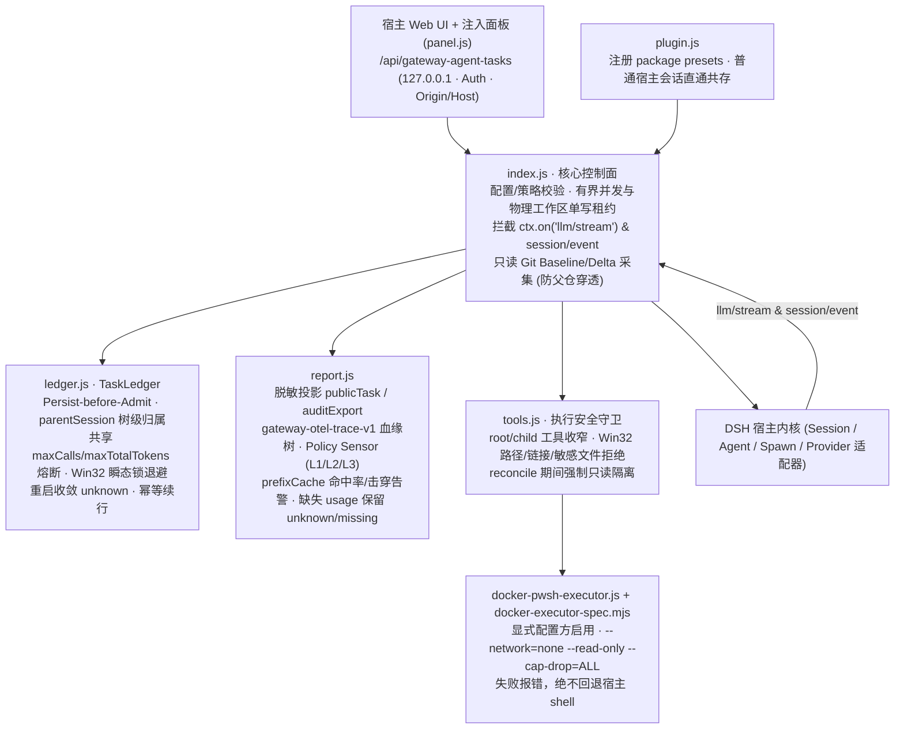
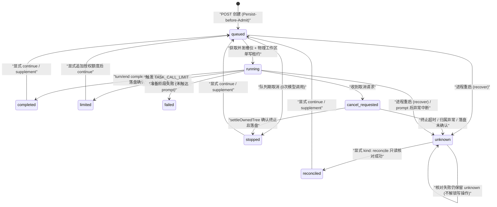

# 系统架构与核心模块边界

`llm-gateway` 是一个挂载在兼容 **DeepSeek Harness (`dsh`) Cordis 插件体系** 缝隙中的受控任务网关控制面。核心运行代码仅由 `integrations/dsh-agent-gateway/` 根目录下的 8 个模块与 `presets/` 组成，与 `ops/`、`smoke/`、`tests/` 及隔离后的历史 Python 缓存实验严格解耦。

---

## 一、 控制面 vs 执行面全局架构

---

## 二、 核心模块职责矩阵（发版运行树，共 22 个文件，含中英 README）

| 模块 | 职责定位 | 明确不做什么（职责边界） |
| :--- | :--- | :--- |
| [plugin.js](../integrations/dsh-agent-gateway/plugin.js) | 插件装配入口：校验宿主服务接口、挂载包内 `presets/`、映射 `executor: docker`、透传 `allowHostSessions: true` | 不替代宿主默认预设，不自动开启任务或选择账号 |
| [index.js](../integrations/dsh-agent-gateway/index.js) | 控制面主循环：HTTP API、工作区单写租约队列、流拦截准入、`settleOwnedTree` 级联取消、`reconcile` 与只读 Git Baseline/Delta 采集 | 不自研 LLM 循环或模型协议，不绕过原生审批，绝不修改 Git 索引或穿透父仓 |
| [ledger.js](../integrations/dsh-agent-gateway/ledger.js) | 持久化账本与策略状态机：原子串行修改（含 Win32 瞬态文件锁退避重试）、`taskOwner` 树级寻根、共享 `maxCalls` 与可选 `maxTotalTokens` 配额、拒绝/工具/审批与 `policySensor` 原子落盘 | 不依赖单次 HTTP 重试计数，不退款失败调用 |
| [tools.js](../integrations/dsh-agent-gateway/tools.js) | 工具与路径边界：`developmentPathDenial`、Win32 歧义名/符号链接/硬链接/敏感文件拦截、`enterReconciliation` | 不充当内核级读取隔离，不放开宿主非隔离命令 |
| [docker-pwsh-executor.js](../integrations/dsh-agent-gateway/docker-pwsh-executor.js) & [docker-executor-spec.mjs](../integrations/dsh-agent-gateway/docker-executor-spec.mjs) | 隔离命令执行器：仅显式配置 `executor: docker` 时挂载于网关专属 preset 隔离域内 | 无镜像或 daemon 时直接报错，永不降级宿主 `pwsh` |
| [report.js](../integrations/dsh-agent-gateway/report.js) & [panel.js](../integrations/dsh-agent-gateway/panel.js) | 脱敏审计投影（`auditExport` / `publicTask`）、OTel 因果血缘树（`gateway-otel-trace-v1`）、确定性 Policy Sensor（`gateway-policy-sensor-v1` L1/L2/L3）、`tokenBudget` 与 `prefixCache` 观测及 Web 阴影 DOM 面板 | 不把 `goal`/原文/`artifact`/文件路径混入审计或传感器，不越权替代人类做业务验收 |

---

## 三、 任务与 Attempt 状态机（无自动重放语义）

---

## 四、 运维、测试与遗留边界
- **`ops/`**（不进入发版 `.tgz`）：[lifecycle.mjs](../integrations/dsh-agent-gateway/ops/lifecycle.mjs) 负责本机受管服务 PID/端口/drain/upgrade/recover；[maintenance.mjs](../integrations/dsh-agent-gateway/ops/maintenance.mjs) 负责停机态审计导出、备份/恢复与两阶段删除；[cost-report.mjs](../integrations/dsh-agent-gateway/ops/cost-report.mjs) 负责事后离线多维成本归因。
- **`legacy/python-cache-experiment/`**：独立归档的 Python FastAPI + Redis `SET NX PX` Singleflight 实验（见其自身 [README.md](../legacy/python-cache-experiment/README.md)），当前与 DSH 控制面保持物理隔离。
